# Mapa da evolução dos modelos de linguagem

Aulas 1.6 e 2.1 a 2.6. Versão em Markdown puro em [mapa-evolucao-modelos-linguagem.md](mapa-evolucao-modelos-linguagem.md). Cada bloco tem a tecnologia à esquerda e suas características à direita (✔ o que trouxe, ✘ onde trava). A seta entre os blocos diz **qual limitação empurrou para a próxima evolução**.

```mermaid
flowchart TB
    subgraph A1 [" Aula 1.6 "]
        direction LR
        T1["<b>2-grama</b><br/>(bigrama)"]
        C1["✔ Prevê a próxima palavra só pela anterior<br/>✔ Estatística pura: frequência de pares<br/>✔ Simples e barato de computar<br/>✘ Sem memória e sem plano global<br/>✘ Repetição / looping (gato preto, gato preto...)<br/>✘ Coerência só local, nunca global"]
        T1 -.- C1
    end

    subgraph A2 [" Aula 2.1 "]
        direction LR
        T2["<b>HMM</b><br/>(Cadeias de Markov ocultas)"]
        C2["✔ Estados ocultos geram observações visíveis<br/>✔ Matriz de transição + matriz de emissão<br/>✔ Forward-Backward · Viterbi · Baum-Welch<br/>✔ Usos: fala, POS tagging, DNA<br/>✘ Hipótese de Markov: só olha o estado anterior<br/>✘ Linear e dependente de dados rotulados"]
        T2 -.- C2
    end

    subgraph A3 [" Aula 2.2 "]
        direction LR
        T3["<b>Redes neurais profundas</b><br/>(feedforward)"]
        C3["✔ Muitas camadas, viabilizadas por dados + GPUs<br/>✔ Word embeddings: palavra vira vetor<br/>✔ Significado parecido = vetores próximos<br/>✔ Janela fixa de palavras anteriores<br/>✘ Fluxo só para frente, ordem mal tratada<br/>✘ Nenhuma memória além da janela"]
        T3 -.- C3
    end

    subgraph A4 [" Aula 2.3 "]
        direction LR
        T4["<b>RNNs</b><br/>LSTM · GRU"]
        C4["✔ Estado recorrente = memória da sequência<br/>✔ Saída depende da entrada + histórico<br/>✔ LSTM: portas de entrada, esquecimento e saída<br/>✔ GRU: menos portas, mais leve<br/>✘ Desvanecimento / explosão de gradiente<br/>✘ Passo a passo: não paraleliza"]
        T4 -.- C4
    end

    subgraph A5 [" Aula 2.4 "]
        direction LR
        T5["<b>Transformers</b><br/>(Attention Is All You Need)"]
        C5["✔ Abandona a recorrência<br/>✔ Self-attention: cada token pesa todos os outros<br/>✔ Positional Encoding preserva a ordem<br/>✔ Atenção + camadas MLP feedforward<br/>✔ Processa tudo em paralelo (GPUs/TPUs)<br/>✔ Escala para bilhões de parâmetros"]
        T5 -.- C5
    end

    subgraph A6 [" Aula 2.5 "]
        direction LR
        T6["<b>Tokens</b><br/>(BPE)"]
        C6["✔ Unidade real: pedaços de palavra<br/>✔ BPE agrupa sequências frequentes<br/>✔ Vocabulário fixado no treino<br/>✔ Lida com palavras novas e erros<br/>✔ Contexto e custo medidos em tokens"]
        T6 -.- C6
    end

    subgraph A7 [" Aula 2.6 "]
        direction LR
        T7["<b>LLMs</b><br/>GPT · BERT · LLaMA · Gemini"]
        C7["✔ Transformer + escala massiva de dados e parâmetros<br/>✔ Pré-treino autossupervisionado → fine-tuning → RLHF<br/>✔ GPT: autoregressivo, foco em gerar<br/>✔ BERT: bidirecional, foco em compreender<br/>✔ Emergentes: zero/few-shot, raciocínio em etapas"]
        T7 -.- C7
    end

    A1 ==>|"falta estrutura além<br/>de pares de palavras"| A2
    A2 ==>|"dependências curtas e<br/>rotulagem cara"| A3
    A3 ==>|"sem memória fora<br/>da janela fixa"| A4
    A4 ==>|"contexto longo difícil<br/>e sem paralelismo"| A5
    A5 ==>|"unidade de entrada<br/>do modelo"| A6
    A6 ==>|"escala massiva<br/>de tokens"| A7

    classDef tech fill:#1e3a8a,stroke:#1e3a8a,color:#ffffff,font-size:16px
    classDef carac fill:#f8fafc,stroke:#94a3b8,color:#0f172a,text-align:left
    classDef top fill:#065f46,stroke:#065f46,color:#ffffff,font-size:16px

    class T1,T2,T3,T4,T6 tech
    class T5,T7 top
    class C1,C2,C3,C4,C5,C6,C7 carac
```

